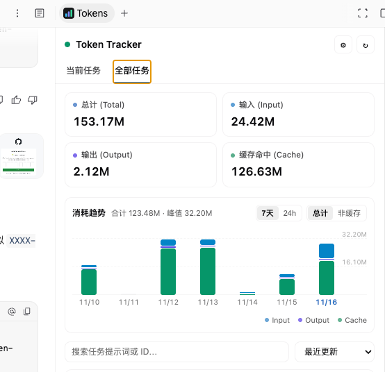
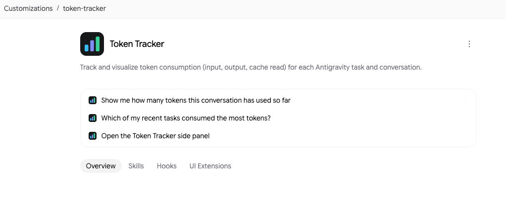
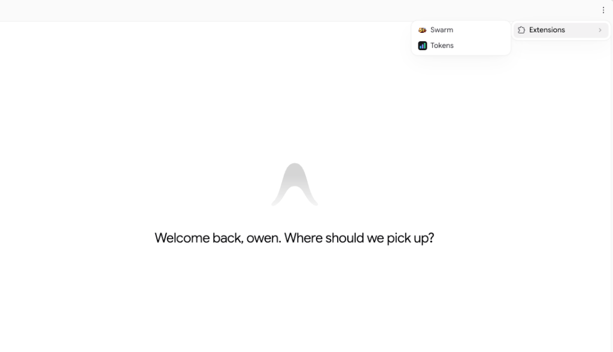

# Token Tracker

一个用于 [Antigravity](https://antigravity.google/) 的轻量级插件，用于统计、追踪并可视化每个任务与会话的 Token 消耗（Input、Output、Cache Read）。

## 界面预览

### 侧边栏统计面板


### 插件详情与快捷入口




## 功能特性

- **每轮自动摘要（PostInvocation Hook）**：每次对话轮次结束后，自动在聊天中展示本轮 Token 消耗（Total / In / Out / Cache）以及当前会话累计消耗，并附带一键打开详情面板的链接。
- **侧边栏可视化面板（Sidecar Web UI）**：
  - **当前任务视图**：查看当前会话的总计、输入、输出、缓存命中统计，以及按轮次（Turn）拆分的明细和规划/执行阶段次数。
  - **全部任务视图**：汇总所有历史会话的 Token 消耗，支持 7 天按日 / 24 小时按小时趋势图、关键词搜索以及按最近更新 / 总 Token / 非缓存 Token 排序。
  - **子代理与 Swarm 聚合**：自动识别并合并当前任务派生出的 Subagent 与 Swarm 成员的 Token 消耗。
  - **Hook 摘要设置**：支持在面板右上角开关「显示本会话累计」。
- **内置 Skill**：支持通过自然语言直接让 Agent 汇总当前会话或历史任务的 Token 消耗，或唤起 Token Tracker 侧边栏面板。

## 目录结构

```text
token-tracker/
├── plugin.json                 # 插件元数据与推荐提示词
├── hooks.json                  # PostInvocation Hook 配置
├── assets/
│   └── logo.svg                # 插件图标
├── hooks/
│   └── report-tokens.mjs       # 每轮结束后输出 Token 摘要的 Hook 脚本
├── lib/
│   └── tokens.mjs              # transcript.jsonl 解析、子代理聚合与时间序列统计
├── sidecars/
│   └── token_panel/            # 侧边栏 Web UI Sidecar
│       ├── sidecar.json
│       ├── package.json
│       ├── main.mjs
│       ├── index.html
│       ├── app.js
│       └── styles.css
└── skills/
    └── token-tracker/
        └── SKILL.md            # Agent 技能说明
```

## 安装方式

将本仓库克隆或软链接到 Antigravity 的插件目录 `~/.gemini/config/plugins/token-tracker`：

```bash
git clone https://github.com/Willian-Wu/Antigravity-Token-Tracker.git ~/.gemini/config/plugins/token-tracker
```

确保系统已安装 Node.js（支持 ES Module，建议 Node 18+），然后在 Antigravity 中启用 `token-tracker` 插件即可。

## 数据来源与隐私

- 插件仅读取本地 `~/.gemini/antigravity/brain/<conversationId>/.system_generated/logs/transcript.jsonl`（以及 `ANTIGRAVITY_APP_DATA` 环境变量指定目录、`antigravity-ide`、`antigravity-cli` 目录下的对应文件）。
- 所有统计与可视化均在本地完成，不会向任何外部服务器发送数据。
- 用户在面板中修改的配置会保存在插件根目录的 `settings.json` 中（已加入 `.gitignore`，不会提交到仓库）。

## License

[MIT](./LICENSE)
